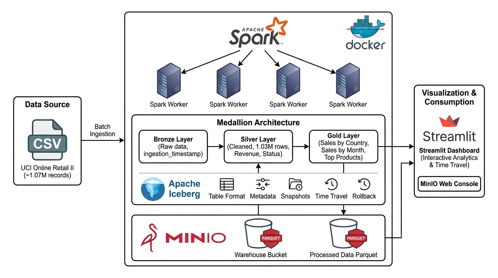

# 🧊 Apache Iceberg Lakehouse — E-commerce Analytics

<p align="center">


</p>

<p align="center">
  <b>Implementation of a Modern Lakehouse Architecture using Apache Spark, Apache Iceberg and MinIO</b>
</p>

<p align="center">
  E-commerce analytics powered by Apache Iceberg, Medallion Architecture and S3-compatible object storage.
</p>

---

## 📌 Project Overview

This project implements a **modern Lakehouse architecture** for e-commerce analytics using **Apache Iceberg** as the central table format, **Apache Spark** as the distributed processing engine, and **MinIO** as S3-compatible object storage.

The project is designed primarily to **study and demonstrate Apache Iceberg**, including its table-management and data-versioning capabilities.

The implementation covers:

* Iceberg table creation and management
* INSERT / UPDATE / DELETE operations
* Snapshot management
* Time Travel
* Rollback
* Schema Evolution
* Bronze / Silver / Gold data layers
* Spark SQL transformations
* Object storage with MinIO
* Containerized infrastructure with Docker
* Interactive visualization with Streamlit

---

# 🎯 Objectives

The main objectives of this project are:

1. Understand the role of **Apache Iceberg** in modern Lakehouse architectures.
2. Build a complete data pipeline using the **Medallion Architecture**.
3. Process real-world e-commerce data with **Apache Spark**.
4. Store Iceberg tables on **S3-compatible object storage** using MinIO.
5. Demonstrate Iceberg's versioning capabilities through snapshots and Time Travel.
6. Demonstrate data recovery using Rollback.
7. Demonstrate Schema Evolution without rebuilding the entire table.
8. Provide a reproducible local environment using Docker.

---

# 🧠 Why Apache Iceberg?

Traditional Data Lakes commonly store analytical data as files such as Parquet.

While this provides flexibility and scalability, managing tables can become difficult when applications require:

* reliable UPDATE and DELETE operations;
* table versioning;
* historical queries;
* schema changes;
* reproducibility;
* recovery from incorrect modifications.

Apache Iceberg introduces a **table-management layer** on top of object storage.

```text
Traditional Data Lake

Object Storage
     │
     ├── file1.parquet
     ├── file2.parquet
     ├── file3.parquet
     └── file4.parquet
```

With Iceberg:

```text
                Apache Iceberg
                     │
        ┌────────────┼────────────┐
        │            │            │
    Metadata     Snapshots      Schema
        │            │            │
        └────────────┼────────────┘
                     │
                     ▼
              Object Storage
                   MinIO
```

Iceberg therefore provides a reliable table abstraction while preserving the flexibility of object storage.

---

# 🏗️ Architecture

The project follows a **Medallion Lakehouse architecture** in which Apache Spark handles ingestion and transformation, Apache Iceberg provides the table-management layer, and MinIO provides S3-compatible object storage.

<p align="center">
  
</p>

<p align="center">
  <i>End-to-end architecture: UCI Online Retail II → Spark → Bronze → Silver → Gold → Apache Iceberg → MinIO → Streamlit</i>
</p>

## 🖼️ Project Screenshots

The following screenshots provide a visual overview of the project environment and its implementation.

<p align="center">
  
</p>

<p align="center">
  
</p>

<p align="center">
  
</p>

<p align="center">
  
</p>

<p align="center">
  
</p>

### 📄 Project documents

- [View the project report (PDF)](images/Rapport_HamzaElmourabit.pdf)
- [View the presentation (PDF)](images/Apache_Iceberg_Soutenance_HamzaElmourabit.pdf)


# 🔧 Technology Stack

| Technology                  | Role                                    |
| --------------------------- | --------------------------------------- |
| **Apache Iceberg 1.6.1**    | Open table format and table management  |
| **Apache Spark 3.5.3**      | Distributed data processing             |
| **MinIO**                   | S3-compatible object storage            |
| **PySpark**                 | Python interface for Spark              |
| **Spark SQL**               | SQL transformations and Iceberg queries |
| **Docker / Docker Compose** | Containerization and reproducibility    |
| **Streamlit**               | Interactive dashboard                   |
| **Python**                  | Data engineering scripts                |
| **UCI Online Retail II**    | Real-world e-commerce dataset           |

---

# 📊 Dataset

The project uses the **Online Retail II** dataset from the UCI Machine Learning Repository.

The dataset contains approximately **1.07 million transaction records** covering two years of e-commerce activity.

### Main columns

| Column        | Description            |
| ------------- | ---------------------- |
| `InvoiceNo`   | Transaction identifier |
| `StockCode`   | Product identifier     |
| `Description` | Product description    |
| `Quantity`    | Quantity purchased     |
| `InvoiceDate` | Transaction timestamp  |
| `UnitPrice`   | Product unit price     |
| `CustomerID`  | Customer identifier    |
| `Country`     | Customer country       |

The dataset is used to demonstrate a realistic data engineering pipeline rather than using synthetic data.

---

# 🥉 Bronze Layer

The Bronze layer contains data close to its original source representation.

The ingestion process:

1. Reads the CSV using Spark.
2. Infers the schema.
3. Creates an Iceberg table.
4. Adds ingestion metadata.

Additional metadata:

```text
ingestion_timestamp
source_file
```

This provides basic data lineage and ingestion traceability.

---

# 🥈 Silver Layer

The Silver layer contains cleaned and transformed data.

### Main transformations

#### Data cleaning

* Trim textual fields.
* Remove invalid records.
* Remove duplicate transactions.
* Filter null critical fields.
* Filter invalid prices.
* Remove zero-quantity transactions.

#### Type normalization

```text
Customer ID
DOUBLE → BIGINT
```

#### Revenue calculation

```text
Revenue = Quantity × Price
```

#### Transaction classification

```text
Quantity < 0
      ↓
RETURN

Quantity >= 0
      ↓
SALE
```

### Silver schema

```text
Invoice
StockCode
Description
Quantity
InvoiceDate
Price
Customer_ID
Country
Revenue
transaction_type
ingestion_timestamp
source_file
```

The resulting Silver table contains:

**1,033,029 rows**

---

# 🥇 Gold Layer

The Gold layer contains analytical datasets generated from the Silver layer.

Three analytical tables are created.

## 🌍 Sales by Country

```text
Country
total_quantity
total_revenue
invoice_count
customer_count
```

Contains:

**43 countries**

---

## 📅 Sales by Month

```text
year
month
total_quantity
total_revenue
invoice_count
customer_count
```

Contains:

**25 monthly records**

---

## 🏆 Top Products

```text
StockCode
Description
total_quantity
total_revenue
invoice_count
```

Contains:

**4,778 products**

---

# 🧊 Apache Iceberg Features Demonstrated

The project includes a dedicated Iceberg demonstration table:

```text
local.iceberg_operations_demo
```

The table initially contains:

```text
id
product
category
quantity
price
status
```

---

## 1️⃣ INSERT

New records are inserted into the Iceberg table.

Example workflow:

```text
Initial Table
A
B
C

      ↓ INSERT

A
B
C
D
```

Iceberg records the resulting table state in a new snapshot.

---

## 2️⃣ UPDATE

An existing record is modified.

Example:

```text
Product B
Quantity: 20 → 50
Price:    15 → 18
```

The modification creates a new table state.

---

## 3️⃣ DELETE

A record is deleted.

Example:

```text
Before:

A
B
C
D

DELETE C

After:

A
B
D
```

The previous state remains accessible through Iceberg snapshots.

---

# 📸 Snapshots

An Iceberg table maintains snapshots representing different states of the table.

Example:

```text
Snapshot 1
A B C
   │
   ▼
Snapshot 2
A B C D
   │
   ▼
Snapshot 3
A B' C D
   │
   ▼
Snapshot 4
A B' D
```

Snapshots provide:

* table versioning;
* historical states;
* reproducibility;
* auditing;
* recovery capabilities.

---

# 🕐 Time Travel

Time Travel allows the user to query a previous version of an Iceberg table.

Conceptually:

```text
Current State
A B D

       ↖

Historical State
A B C D
```

The project demonstrates historical queries using Iceberg snapshot references.

Example:

```sql
SELECT *
FROM local.iceberg_operations_demo
VERSION AS OF <snapshot_id>;
```

### Use cases

* Auditing
* Debugging
* Historical analysis
* Reproducing previous results
* Investigating incorrect data modifications

---

# ↩️ Rollback

Rollback restores an Iceberg table to a previous snapshot.

Difference:

| Feature         | Purpose                    |
| --------------- | -------------------------- |
| **Time Travel** | Read a historical state    |
| **Rollback**    | Restore a historical state |

Example:

```text
Current State
A B D

      ↓ ROLLBACK

Previous State
A B C D
```

The project demonstrates rollback using the Iceberg catalog procedure:

```sql
CALL local.system.rollback_to_snapshot(
    'local.iceberg_operations_demo',
    <snapshot_id>
);
```

---

# 🔄 Schema Evolution

The project also demonstrates Iceberg Schema Evolution.

Initial schema:

```text
id
product
category
quantity
price
status
```

A new column is added:

```sql
ALTER TABLE local.iceberg_operations_demo
ADD COLUMN discount DOUBLE;
```

New schema:

```text
id
product
category
quantity
price
status
discount
```

Existing records remain compatible with the new schema.

This demonstrates how Iceberg allows table schemas to evolve without unnecessarily rebuilding the entire dataset.

---

# 🗂️ Project Structure

```text
iceberg-lakehouse-project/
│
├── docker-compose.yml
├── README.md
│
├── data/
│   └── online_retail_II.csv
│
├── spark/
│   ├── Dockerfile
│   ├── requirements.txt
│   │
│   └── jobs/
│       ├── 01_create_tables.py
│       ├── 02_bronze.py
│       ├── 03_bronze_to_silver.py
│       ├── 04_silver_to_gold.py
│       ├── 05_iceberg_operations.py
│       ├── 06_time_travel.py
│       ├── 07_rollback.py
│       └── 08_schema_evolution.py
│
├── sql/
│   ├── transformation.sql
│   └── time_travel.sql
│
├── dashboard/
│   ├── Dockerfile
│   ├── requirements.txt
│   └── app.py
│
├── docs/
│
└── notebooks/
```

---

# 🐳 Docker Infrastructure

The project uses Docker to create a reproducible local environment.

Main services:

```text
┌──────────────────────────────┐
│         Docker Compose       │
├──────────────────────────────┤
│                              │
│  Spark Master                │
│  Spark Worker                │
│  MinIO                       │
│  Streamlit Dashboard         │
│                              │
└──────────────────────────────┘
```

### MinIO

MinIO provides the S3-compatible storage layer.

Default local endpoints:

```text
MinIO API:
http://localhost:9000

MinIO Console:
http://localhost:9001
```

The Iceberg warehouse is stored in the MinIO:

```text
warehouse
```

---

# 📊 Dashboard

A read-only Streamlit dashboard provides a visual interface for exploring the Gold analytics generated from the Iceberg tables.

It currently provides:

* revenue and invoice indicators;
* monthly revenue trend;
* revenue by country with a country filter;
* searchable top-products table.

The dashboard reads CSV exports written by the Spark Gold job into the shared `exports/` directory. These exports are a presentation layer, not a second Iceberg catalog or a direct Streamlit-to-Iceberg connection. Spark and Iceberg remain responsible for processing and table management; MinIO remains the object store.

---

# 🚀 Getting Started

## 1. Clone the repository

```bash
git clone https://github.com/HamzaElmourabit/iceberg-lakehouse-project.git
cd iceberg-lakehouse-project
```

Replace the repository URL above with the final GitHub repository URL if the repository name differs.

---

## 2. Start the infrastructure

```powershell
docker compose up -d --build
```

Open the dashboard at:

```text
http://localhost:8501
```

Check the running containers:

```powershell
docker ps
```

---

## 3. Run the Bronze pipeline

```powershell
docker exec -it iceberg-spark-master /opt/spark/bin/spark-submit `
  --master spark://spark-master:7077 `
  --jars /opt/spark/jars/iceberg-spark-runtime-3.5_2.12-1.6.1.jar `
  /opt/spark/jobs/02_bronze.py
```

---

## 4. Run Silver transformation

```powershell
docker exec -it iceberg-spark-master /opt/spark/bin/spark-submit `
  --master spark://spark-master:7077 `
  --jars /opt/spark/jars/iceberg-spark-runtime-3.5_2.12-1.6.1.jar `
  /opt/spark/jobs/03_bronze_to_silver.py
```

---

## 5. Run Gold transformation

```powershell
docker exec -it iceberg-spark-master /opt/spark/bin/spark-submit `
  --master spark://spark-master:7077 `
  --jars /opt/spark/jars/iceberg-spark-runtime-3.5_2.12-1.6.1.jar `
  /opt/spark/jobs/04_silver_to_gold.py
```

The batch jobs replace their target Iceberg table contents, so rerunning this full pipeline does not append duplicate copies of the same dataset. Run Bronze, then Silver, then Gold. The Gold job exports the three Gold results as CSV files into the host `exports/` directory, which is shared read-only with Streamlit. After it completes, reload the dashboard at `http://localhost:8501`.

---

# 🧪 Iceberg Demonstration

Run the Iceberg operations:

```powershell
docker exec -it iceberg-spark-master /opt/spark/bin/spark-submit `
  --master spark://spark-master:7077 `
  --jars /opt/spark/jars/iceberg-spark-runtime-3.5_2.12-1.6.1.jar `
  /opt/spark/jobs/05_iceberg_operations.py
```

### Time Travel

```powershell
docker exec -it iceberg-spark-master /opt/spark/bin/spark-submit `
  --master spark://spark-master:7077 `
  --jars /opt/spark/jars/iceberg-spark-runtime-3.5_2.12-1.6.1.jar `
  /opt/spark/jobs/06_time_travel.py
```

### Rollback

```powershell
docker exec -it iceberg-spark-master /opt/spark/bin/spark-submit `
  --master spark://spark-master:7077 `
  --jars /opt/spark/jars/iceberg-spark-runtime-3.5_2.12-1.6.1.jar `
  /opt/spark/jobs/07_rollback.py
```

### Schema Evolution

```powershell
docker exec -it iceberg-spark-master /opt/spark/bin/spark-submit `
  --master spark://spark-master:7077 `
  --jars /opt/spark/jars/iceberg-spark-runtime-3.5_2.12-1.6.1.jar `
  /opt/spark/jobs/08_schema_evolution.py
```

---

# 📈 Results

The implemented pipeline produced the following results:

| Layer / Dataset  |             Result |
| ---------------- | -----------------: |
| Source dataset   |    ~1.067M records |
| Silver           | **1,033,029 rows** |
| Gold – Countries |             **43** |
| Gold – Months    |             **25** |
| Gold – Products  |          **4,778** |

The project successfully demonstrates:

```text
✓ Apache Iceberg Tables
✓ INSERT
✓ UPDATE
✓ DELETE
✓ Snapshots
✓ Time Travel
✓ Rollback
✓ Schema Evolution
✓ Spark SQL
✓ Medallion Architecture
✓ MinIO Object Storage
✓ Dockerized Infrastructure
```

---

# 🎓 Academic Context

**Institution:** ENSA Berrechid
**Program:** Big Data and Information Systems Engineering
**Project:** Individual University Project
**Student:** Hamza Elmourabit
**Supervisor:** Pr. Karim Lamiae
**Academic Year:** 2026–2027

---

# 🔮 Future Improvements

Potential extensions include:

* deployment on AWS S3 or another cloud object store;
* Apache Airflow orchestration;
* Kafka-based streaming ingestion;
* Kubernetes deployment;
* automated data-quality validation;
* Spark cluster deployment;
* monitoring and observability;
* advanced Iceberg maintenance operations;
* integration with enterprise BI platforms.

These features are considered **future improvements** and are not part of the current implementation.

---

# 📚 Key Concepts Demonstrated

This project provides practical experience with:

**Data Engineering**

* ETL / ELT
* Data Lakehouse
* Medallion Architecture
* Data Transformation
* Data Aggregation

**Apache Iceberg**

* Iceberg Tables
* Table Metadata
* Snapshots
* Time Travel
* Rollback
* Schema Evolution
* Table-level data operations

**Big Data**

* Apache Spark
* PySpark
* Spark SQL

**Cloud / Infrastructure**

* Object Storage
* S3-compatible APIs
* MinIO
* Docker
* Docker Compose

---

# 👨‍💻 Author

**Hamza Elmourabit**

Big Data & Information Systems Engineering Student
ENSA Berrechid

Interested in:

**Data Engineering • Big Data • AI • Lakehouse Architecture • Data Platforms**

---

## ⭐ Project Focus

> **This project focuses on understanding and demonstrating Apache Iceberg as a modern open table format for building reliable Lakehouse architectures on top of object storage.**

<p align="center">
  <b>Apache Spark × Apache Iceberg × MinIO × Lakehouse</b>
</p>
